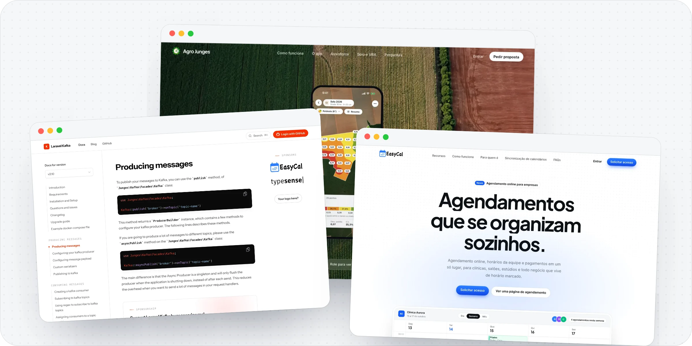

Somos uma empresa brasileira de tecnologia. Desenvolvemos software, criamos produtos digitais e construímos soluções sob medida para empresas que precisam de eficiência, clareza e resultados concretos. Começamos entendendo o problema antes de propor qualquer solução.

## Nossos serviços

**Consultoria em tecnologia.** Ajudamos sua empresa a tomar melhores decisões de tecnologia: avaliamos os sistemas que você já tem, revisamos arquitetura e código e definimos um plano claro para evoluir com segurança.

**Desenvolvimento de sites.** Criamos sites institucionais, pessoais e páginas de marketing focadas em clareza, credibilidade e conversão, alinhadas à identidade e aos objetivos da sua empresa.

**Automações com inteligência artificial.** Criamos automações inteligentes para eliminar tarefas manuais, reduzir erros e tornar processos mais eficientes no seu dia a dia.

**Sistemas customizados.** Desenvolvemos sistemas sob medida para atender fluxos específicos da operação, substituindo planilhas e ferramentas genéricas por soluções alinhadas à realidade da empresa.

## Nossos produtos

**[Agro Junges](https://agrojunges.com).** Plataforma de gestão agrícola para o produtor rural. Acompanhe a lavoura com imagens de satélite, análises de solo, mapas de aplicação em taxa variável e controle de insumos, estoque e custos da propriedade, na web e no celular.

**[EasyCal](https://easycal.app).** Plataforma completa para gestão de agendamentos online. Ideal para clínicas, consultórios, salões e prestadores de serviço que precisam organizar sua agenda de forma eficiente.

**Automação de Atendimento.** Chatbot inteligente integrado ao WhatsApp para automatizar o atendimento inicial, qualificar leads e agilizar respostas, liberando sua equipe para focar no que importa.

**[Laravel Kafka](https://github.com/mateusjunges/laravel-kafka).** Pacote open source que leva o Apache Kafka para aplicações Laravel, para produzir e consumir mensagens com poucas linhas de código.

## Como trabalhamos

**Descoberta.** Entendemos o seu negócio, os gargalos da operação e o que realmente precisa ser resolvido.

**Construção.** Desenvolvemos em ciclos curtos, com entregas frequentes e comunicação transparente.

**Entrega.** Colocamos a solução no ar com testes, monitoramento e suporte para a sua equipe.

## O que valorizamos

**Simplicidade.** A melhor solução é a mais simples que resolve o problema. Código limpo, interfaces claras, processos diretos.

**Comunicação clara.** Falamos a sua língua. Explicamos decisões técnicas de forma compreensível e mantemos você informado em cada etapa.

**Resultado acima de tudo.** Tecnologia é meio, não fim. O que importa é resolver o problema do seu negócio, não usar a ferramenta da moda.

Trabalhamos principalmente com PHP, Laravel, TypeScript, React, Expo e Tailwind CSS.

 

Fale com a gente pelo [site](https://jungestecnologia.com/contato) ou pelo [Instagram](https://instagram.com/jungestecnologia).

Junges Tecnologia LTDA. Brasil.
